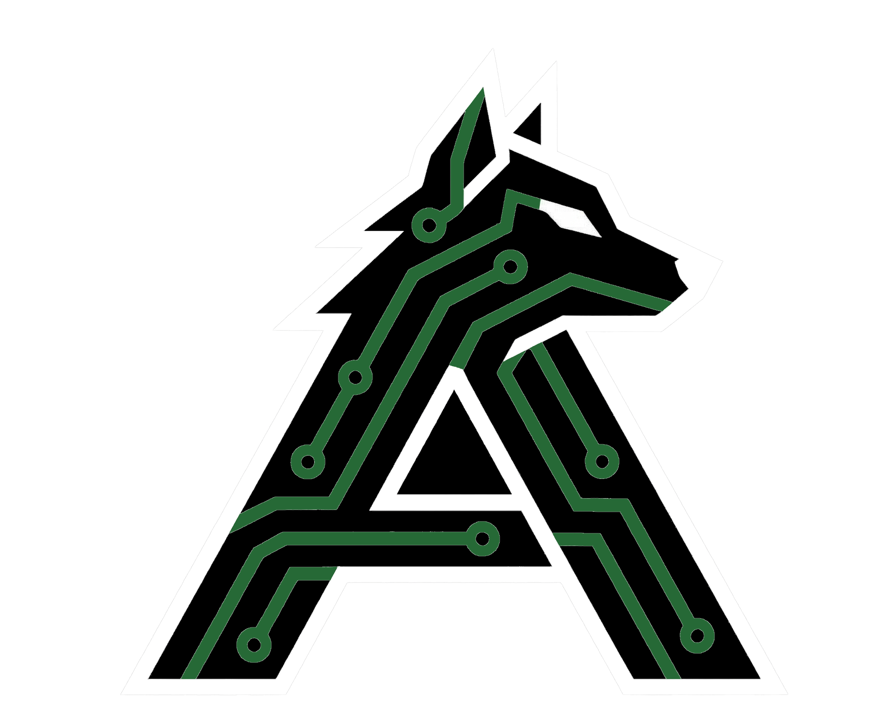

<link rel="preconnect" href="https://fonts.googleapis.com">
<link href="https://fonts.googleapis.com/css2?family=Inter:wght@300;400;500;600&family=DM+Mono:wght@300;400&display=swap" rel="stylesheet">

  <!-- Header -->
  <header class="flasher-header">
    

      
    

    

      
Apex Core Flasher

      
Zigbee Bridge — Web Setup Tool

    

    v1.0.0
  </header>

  <!-- Steps -->
  

    <!-- Warning: Test Credentials -->
    

      

        

          ⚠️
          

            <strong style="color: #ff9800; display: block; margin-bottom: 2px;">Developer Mode / Uncertified Device</strong>
            This tool uses <strong>Matter Test Credentials</strong>. Your smart home platform (Apple Home, Google Home, etc.) will display a warning that this is an "Uncertified Accessory." This is normal for Apex Core development hardware.
          

        

      

    

    <!-- Step 1 -->
    

      

        
1

        

          
Generate Credentials

          
Create unique pairing data for this device

        

        Ready
      

      

        
Generates a unique discriminator, passcode, and SPAKE2+ verifier entirely in your browser. Nothing leaves this page.

        

          
          Initializing…
        

        

          <button class="btn btn-primary" id="btnGenerate" onclick="window.doGenerateCredentials()" disabled>
            Generate Credentials
          </button>
        

        
// Waiting for service worker…

        

          

            

              <svg width="13" height="13" viewBox="0 0 16 16" fill="rgba(255,159,10,0.9)">
                <path d="M8 1a2 2 0 0 1 2 2v4H6V3a2 2 0 0 1 2-2zm3 6V3a3 3 0 0 0-6 0v4a2 2 0 0 0-2 2v4a2 2 0 0 0 2 2h6a2 2 0 0 0 2-2V9a2 2 0 0 0-2-2z"/>
              </svg>
              Pairing Credentials — Save before continuing
            

            

              

                <canvas id="qrCanvas"></canvas>
                
Scan to pair

              

              

                

                  <label class="field-label">Manual Pairing Code</label>
                  
—

                

                

                  <label class="field-label">Discriminator</label>
                  
—

                

                

                  <label class="field-label">Passcode</label>
                  
—

                

              

            

          

        

      

    

    <!-- Step 2 -->
    

      

        
2

        

          
Flash Device

          
Write firmware and credentials in one operation

        

        Waiting
      

      

        
Connects to your device and flashes the firmware and NVS credentials in a single operation.

        

          <esp-web-install-button id="espInstallBtn" manifest="">
            <button slot="activate" class="btn btn-primary" id="btnFlash" disabled>Flash Device</button>
          </esp-web-install-button>
          <button class="btn btn-glass" id="btnFlashDone" onclick="window.onFlashDone()" disabled>Mark Complete</button>
          <button class="btn btn-glass" id="btnDownload" onclick="window.doDownloadNVS()" disabled>Download NVS</button>
        

        
// Complete Step 1 first

      

    

    <!-- Step 3 -->
    

      

        
✓

        

          
Device Ready

          
Commission using the pairing code from Step 1

        

        Waiting
      

      

        
Your Apex Core is ready. Open Apple Home, Google Home, or Home Assistant and enter the manual pairing code.

        

          <button class="btn btn-glass" onclick="window.doReset()">Set Up Another Device</button>
        

      

    

  

---

-   [:octicons-arrow-right-24: **Next Step: Adding To Home (Step 3)**](./commissioning.md)

