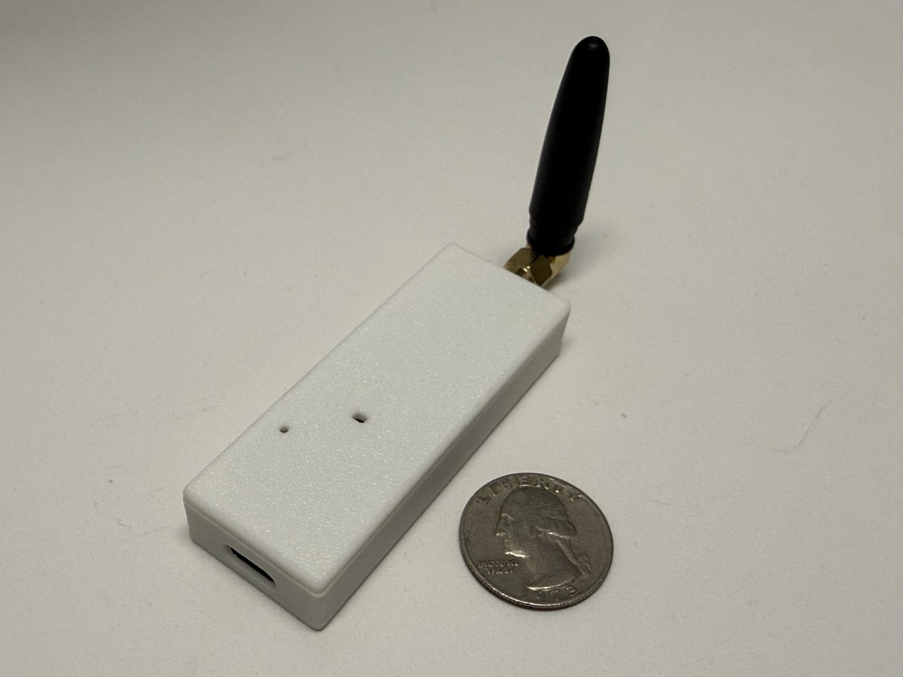

# Step 1: Attach the Antenna

Your Crosswalk Gateway comes almost ready to go. The only thing you need to do before setup is attach the antenna, which the Gateway uses to talk to your Wi-Fi and your Crosswalk sensors.

!!! info "No need to open the case"
    The small adapter inside the case is already installed. You only need to attach the external antenna.

---

## What You Need
- **Crosswalk Gateway**
- **2.4GHz Antenna** (in the box)

## Attaching the Antenna

1.  **Find the Connector:** Look for the gold, threaded connector on the end of the Gateway case.

2.  **Screw on the Antenna:** Line the antenna up with the connector and turn it clockwise until it is finger-tight. You don't need any tools, and you shouldn't force it.

    

!!! warning "Attach the antenna before you power on"
    Without the antenna, the Gateway may not find your Wi-Fi network or your sensors. Always attach it before plugging the Gateway in.

---

-   [:octicons-arrow-right-24: **Next Step: Flashing (Step 2)**](./gateway-flashing.md)

