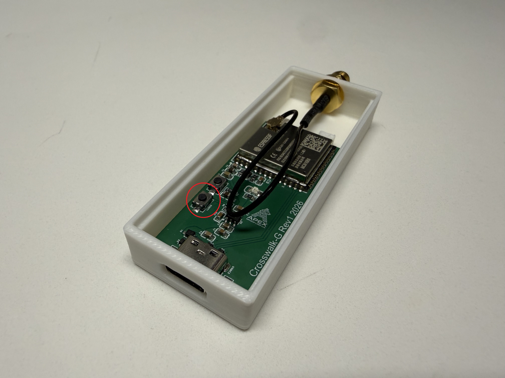
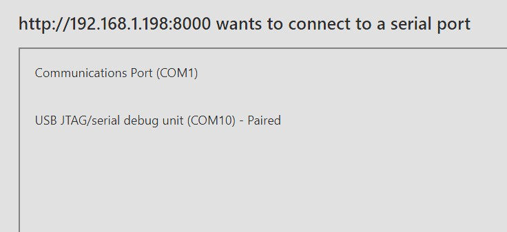
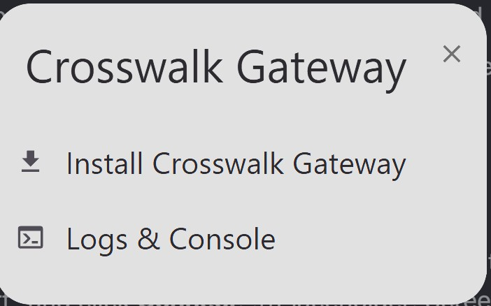
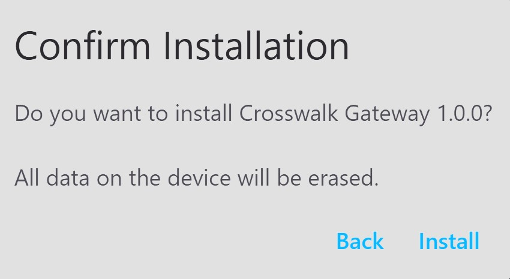

# Step 2: Flashing Your Gateway

The Crosswalk Gateway is the "hub" for your Apex Crosswalk sensors. Before it joins your home, you'll install the latest firmware on it.

!!! tip "Why we Flash First"
    To ensure you have the absolute latest features and the most secure, privacy-focused version of our local software, we start every setup by quickly updating the device's firmware. This ensures your hardware is running the best possible version of the Crosswalk Gateway before it joins your home.

!!! info "Browser Requirement"
    You **must** use **Google Chrome** or **Microsoft Edge** on a computer to flash your device. We do not support other browsers for flashing.

---

## Preparation
- **Crosswalk Gateway Hub**
- **USB-C Cable**
- **Computer** with Chrome or Edge installed.

## Finding the BOOT Button

To flash the Gateway, you need to hold down its BOOT button while you plug it in. The button is inside the case, so **take the lid off the case** first. There are two small buttons on the board. The BOOT button is the one **closest to the USB-C port**, circled below.

## Flashing Procedure

1.  **Connect:** Hold down the BOOT button, circled in red above. With the button held down, plug the Gateway into your computer's USB port. Let go of the boot button once it's plugged in.

2.  **Start Flash:** Click the **Install** button below.

    

        
        <esp-web-install-button manifest="../gateway-manifest.json">
            <button slot="install" class="md-button md-button--primary">Install Crosswalk Gateway</button>
        </esp-web-install-button>
    

3.  **Select Device:** A small window will pop up. Select the entry that says "USB Serial" or "Enhanced COM Port" and click **Connect**.

    

4. **Install Gateway Firmware:** Click Install Crosswalk Gateway

    

5. **Click Confirm:** Click Confirm to finish installation.

    

6.  **Wait:** Do not unplug the device until the screen says "Installation Complete". 

7.  **Finish:** Unplug the Gateway and put the lid back on the case. Your Gateway is now ready to connect to your home network.

---

-   [:octicons-arrow-right-24: **Next Step: Connecting & Setup (Step 3)**](./gateway-setup.md)

