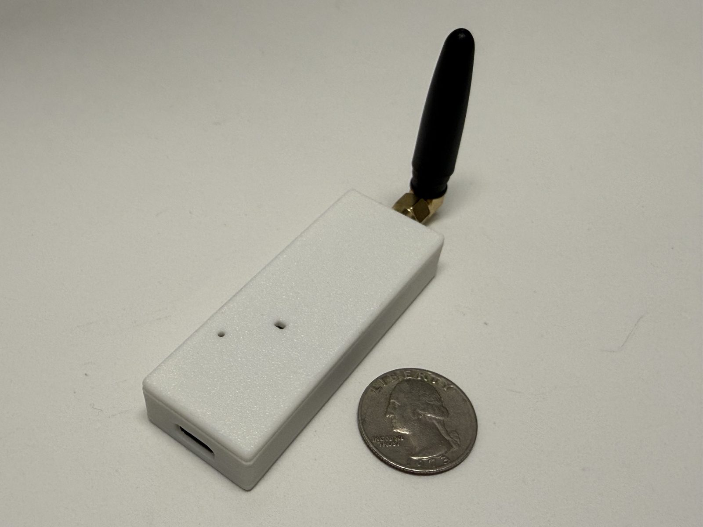
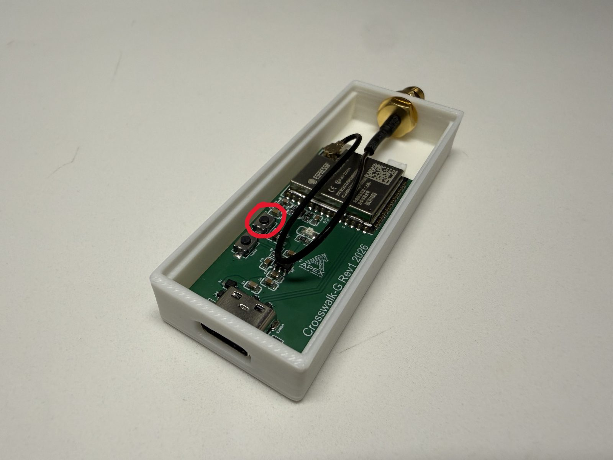
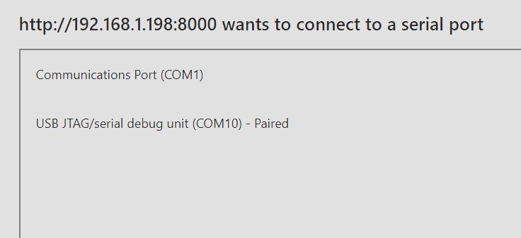
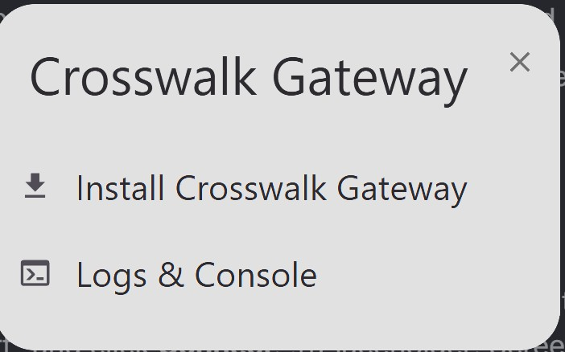
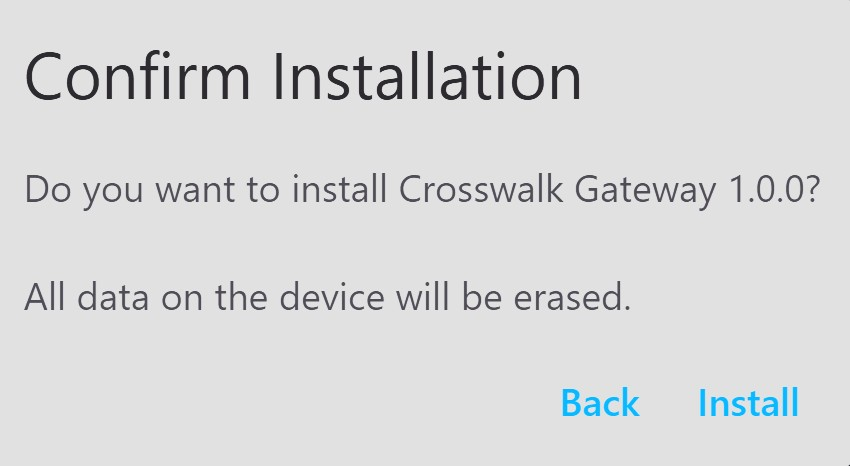

# Step 1: Flashing Your Gateway

The Crosswalk Gateway is the "hub" for your Apex Crosswalk sensors. First, you need to connect the antenna. You may need to remove the case lid in order to best secure the antenna.

Once the antenna is connected, remove the lid so you can access to device's BOOT button, circled below. If you have a paperclip or other device, you can access the BOOT button that way through the lid as well.

!!! tip "Why we Flash First"
    To ensure you have the absolute latest features and the most secure, privacy-focused version of our local software, we start every setup by quickly updating the device's firmware. This ensures your hardware is running the best possible version of the Crosswalk Gateway before it joins your home.

!!! info "Browser Requirement"
    You **must** use **Google Chrome** or **Microsoft Edge** on a computer to flash your device. We do not support other browsers for flashing.

---

## Preparation
- **Crosswalk Gateway Hub**
- **USB-C Cable**
- **Computer** with Chrome or Edge installed.

## Flashing Procedure

1.  **Connect:** Hold the BOOT button of your device, circled in red above. With the button held down, plug the Gateway into your computer's USB port. Let go of the boot button once it's plugged in.

2.  **Start Flash:** Click the **Install** button below.

    

        
        <esp-web-install-button manifest="../gateway-manifest.json">
            <button slot="install" class="md-button md-button--primary">Install Crosswalk Gateway</button>
        </esp-web-install-button>
    

3.  **Select Device:** A small window will pop up. Select the entry that says "USB Serial" or "Enhanced COM Port" and click **Connect**.

    

4. **Install Gateway Firmware:** Click Install Crosswalk Gateway

    

5. **Click Confirm:** Click Confirm to finish installation.

    

6.  **Wait:** Do not unplug the device until the screen says "Installation Complete". 

7.  **Finish:** Your Gateway is now ready to connect to your home network.

---

-   [:octicons-arrow-right-24: **Next Step: Connecting & Setup (Step 2)**](./gateway-setup.md)

