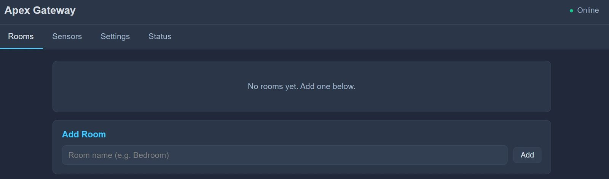
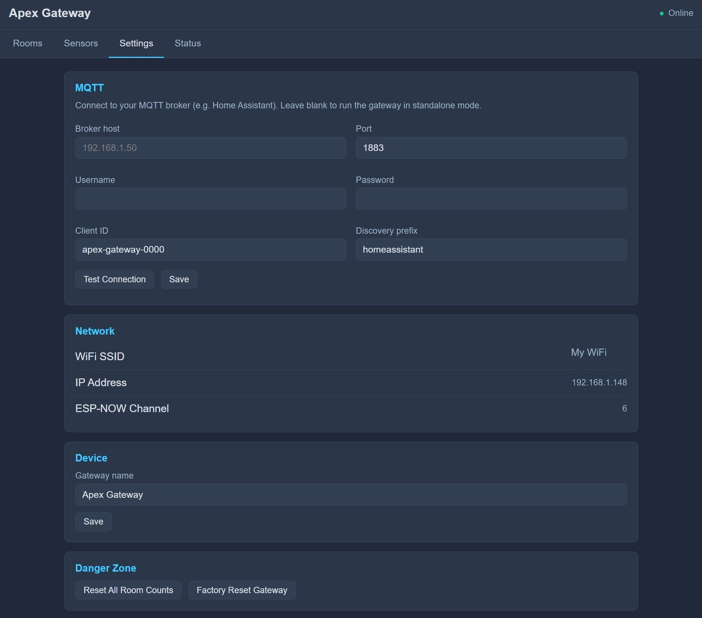
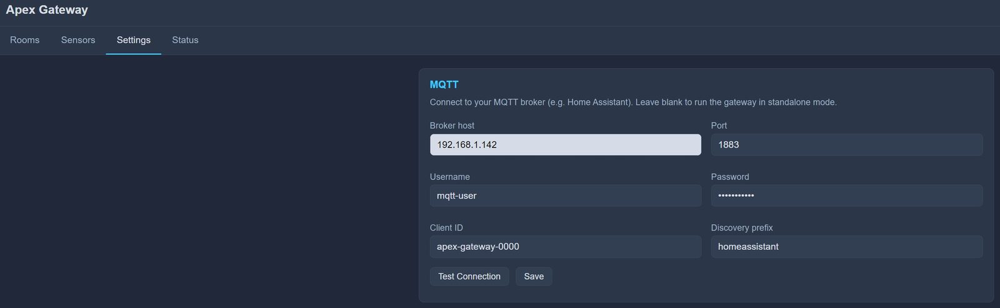
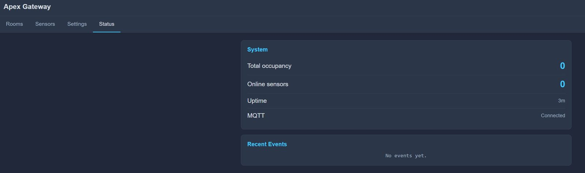
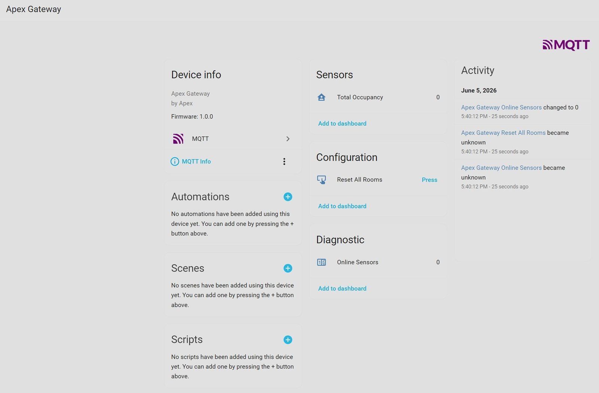
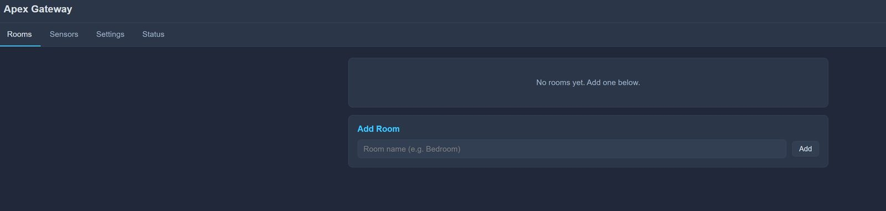
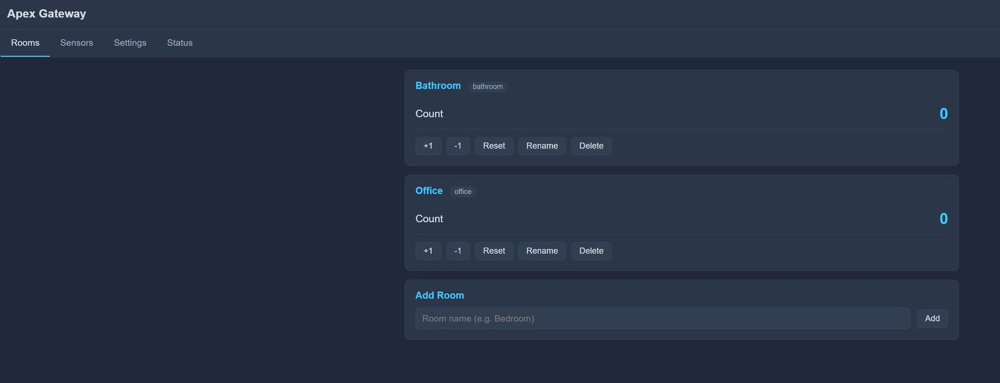

# Step 2: Connecting and Setup

Now you need to connect your Gateway to your home Wi-Fi and set up its connection to your smart home app.

---

## 1. Wi-Fi Configuration

1.  **Power On:** Plug your Gateway into any USB power outlet. You will need to unplug your device and plug it back in after installing the firmware. 

2.  **Find the Hotspot:** On your phone or computer, open your Wi-Fi settings. Look for a network named `Apex-Setup`.

    

3.  **Connect:** Join that network. Once connected, open a web browser on your phone and visit "http://192.168.4.1".

    

4.  **Enter Credentials:** Pick your home's 2.4GHz Wi-Fi network from the list, type your password, and click **Connect**.

    

    !!! tip "List says 'No networks found'?"
        Give the Gateway a few seconds to finish scanning and reload the page. You can also type your network name into the top box by hand.

5.  **Reboot:** The Gateway will save the settings and restart. It is now connected to your home network. Reconnect to your home Wi-Fi network on your phone.

---

## 2. The Apex Dashboard
Your Gateway has its own "Control Panel" that you can access from any browser in your house.

1.  **Open Browser:** Type `http://apex.local` into your browser's address bar.

    !!! tip "Trouble finding the dashboard?"
        If `http://apex.local` doesn't load, your router may not support local names. You can find the **IP address** of your Gateway in your router's device list (it will appear as 'Crosswalk-Gateway') and type that number into your browser instead.

2.  **The Main Screen:** You should now see the Apex Gateway dashboard, with the Rooms, Sensors, Settings, and Status tabs across the top.

  

---

## 3. Smart Home Connection (MQTT)
To send the person counts to Home Assistant or other apps, you need to set up "MQTT".

1.  **Go to Settings:** On the dashboard, click **Settings** and then **MQTT**.

    

2.  **Type Broker Info:** Enter your MQTT Broker's address (usually the IP of your Home Assistant server).

    

3.  **Save:** Click **Save**. The dashboard should now say "MQTT Connected".

    

---

## 4. Gateway Connected
Your Apex Crosswalk Gateway is now connected and set up. It uses the Home Assistant discovery message by default, so your Gateway and your Crosswalk sensors appear automatically in Home Assistant or any smart home hub of your choice. Go check it out in your smart home!

Your Apex Gateway lists information for you here to include 'Total Occupancy'. This is an aggregation of all room counts between all of your Crosswalk Sensors. If two people are in your 'Office' and one person is in the 'Living Room' this count would be 3. This also lists and links to all of your Crosswalk sensor devices. You can easily click 'Reset All Rooms' to revert the room counts to 0 across your entire setup.

---

## 5. Add Rooms
Now we need to add and configure rooms before adding a sensor. Go to the Rooms tab at the top and add some rooms!

1. **Add a Room:** Type in the room name and click 'Add'

  

2. **Configure Rooms:** Now that you have rooms set up, you can reset the counts, increment, decrement the room count, rename the room, or delete the room. This all syncs over MQTT to your smart home setup.

  

3. **Set up Sensors:** Now it's time to go set up your Crosswalk sensors. Click the link below to start setting up a sensor.

---

-   [:octicons-arrow-right-24: **Next Step: Set up your Sensors**](./index.md)
-   [:octicons-arrow-right-24: **Keeping the Gateway Updated**](./gateway-updates.md)

