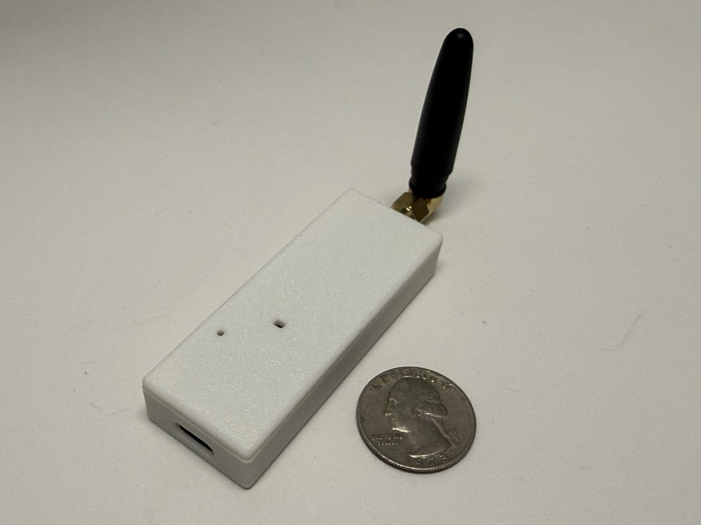

# Getting Started with Crosswalk Gateway

The **Crosswalk Gateway** is the heart of your person-counting ecosystem. It acts as the bridge between your battery-powered Crosswalk sensors (using ESP-NOW) and your smart home controller (over MQTT).

---

## Unboxing

The Crosswalk Gateway is the central coordinator for your person-counting sensors.

*   **1x Crosswalk Gateway:** Powered by an ESP32-S3.
*   **1x Crosswalk Gateway Case:** Fits the Crosswalk Gateway board
*   **1x u.FL/IPEX to SMA adapter:** Already installed inside the case. Connects the Gateway board to the antenna.
*   **1x 2.4GHz Antenna:** For Wi-Fi and ESP-NOW. You'll screw this on in Step 1.
*   **USB-C Cable NOT included:** You'll need one to flash the Gateway and to power it afterwards.

---

## Setup Process

To get started, follow our linear walkthrough to set up your Gateway.

1.  **Attach the Antenna:** Screw the antenna onto the Gateway.
2.  **Flashing:** Install the latest firmware.
3.  **Connecting & Setup:** Connect to Wi-Fi and MQTT.

!!! info "You'll need a computer for Step 2"
    To flash the Gateway, you'll need **Google Chrome** or **Microsoft Edge** on a **Windows PC or Mac**. You'll use your phone in Step 3 to connect the Gateway to your Wi-Fi.

!!! info "Dependency"
    You must complete this Gateway setup **before** attempting to install your Crosswalk Sensors. Sensors will not be able to transmit data until a Gateway is online and within range.

-   [:octicons-arrow-right-24: **Start Step 1: Attach the Antenna**](./gateway-assembly.md)

