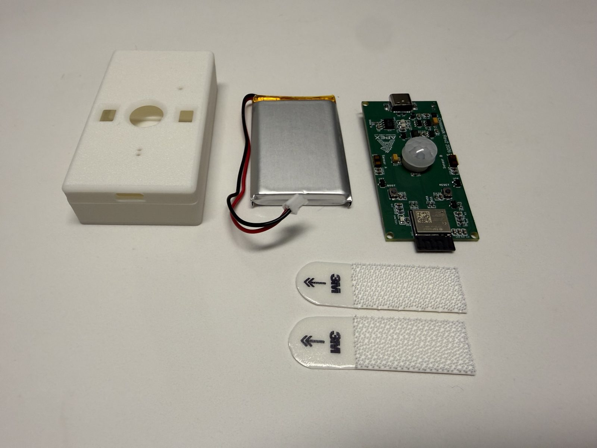

# Getting Started with Apex Crosswalk

## Count people, not motion.

Apex Crosswalk counts people as they enter and leave, so your lights, heating, and fans respond to real occupancy. Private, local, and energy efficient.

By counting people as they pass through a doorway, it eliminates the "ghosting" and delays associated with traditional motion sensors.

---

## Unboxing

The Crosswalk Sensor is a high-precision occupancy detector. It comes in two versions:

- **Battery-Powered:** Runs for months on a rechargeable battery, with no wires to the doorway.
- **Hardwired:** Stays plugged into USB-C power, so there is no battery to charge.

=== "Battery-Powered"

    *   **1x Crosswalk Sensor Board:** Featuring dual sensing zones.
    *   **1x 3D Printed Case & Lid:** For sleek mounting.
    *   **1x LiPo Battery:** Provides months of wireless operation.
    *   **2x Adhesive Mounting Strips**
    *   **USB-C Charging Cable NOT included**

=== "Hardwired"

    *   **1x Crosswalk Sensor Board:** Featuring dual sensing zones.
    *   **1x 3D Printed Case & Lid:** For sleek mounting.
    *   **2x Adhesive Mounting Strips**
    *   **USB-C Cable and USB Power Adapter NOT included**

---

## Setup Process

Follow the linear walkthrough to get your Crosswalk sensor up and running.

!!! info "Set up your Gateway first"
    Your sensors talk to the [Crosswalk Gateway](./gateway.md), not directly to your Wi-Fi. The Gateway needs to be online before a sensor can pair or report counts.

-   [:octicons-arrow-right-24: **Start Step 1: Flashing**](./sensor-flashing.md)

