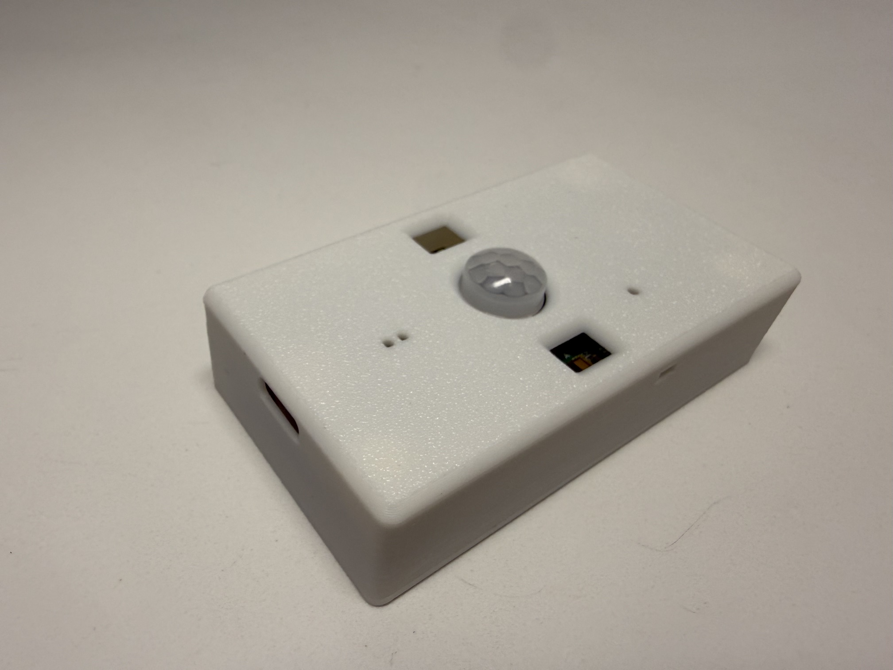

# Getting Started with Apex Crosswalk

!!! warning "Set up your Gateway first"
    Your sensors talk to the [Crosswalk Gateway](./gateway.md), not directly to your Wi-Fi. A sensor can't pair or report counts until the Gateway is set up and online. If you haven't done that yet, [start with the Gateway](./gateway.md) and come back here afterwards.

## Count people, not motion.

Apex Crosswalk counts people as they enter and leave, so your lights, heating, and fans respond to real occupancy. Private, local, and energy efficient.

By counting people as they pass through a doorway, it eliminates the "ghosting" and delays associated with traditional motion sensors.

---

## Unboxing

The Crosswalk Sensor is a high-precision occupancy detector. It comes in two versions:

- **Battery-Powered:** Runs for months on a rechargeable battery, with no wires to the doorway.
- **Hardwired:** Stays plugged into USB-C power, so there is no battery to charge.

Your sensor arrives fully assembled in its case. There is nothing to put together.

=== "Battery-Powered"

    *   **1x Crosswalk Sensor:** Featuring dual sensing zones, assembled in its case.
    *   **1x LiPo Battery:** Already inside the case. You'll plug it in during pairing.
    *   **2x Adhesive Mounting Strips:** In the sensor bag. Keep these for mounting.
    *   **USB-C Charging Cable NOT included**

=== "Hardwired"

    *   **1x Crosswalk Sensor:** Featuring dual sensing zones, assembled in its case.
    *   **2x Adhesive Mounting Strips:** In the sensor bag. Keep these for mounting.
    *   **USB-C Cable and USB Power Adapter NOT included**

---

## Setup Process

Follow the linear walkthrough to get your Crosswalk sensor up and running.

!!! info "You'll need a computer for Step 1"
    To flash the sensor, you'll need **Google Chrome** or **Microsoft Edge** on a **Windows PC or Mac**.

-   [:octicons-arrow-right-24: **Start Step 1: Flashing**](./sensor-flashing.md)

