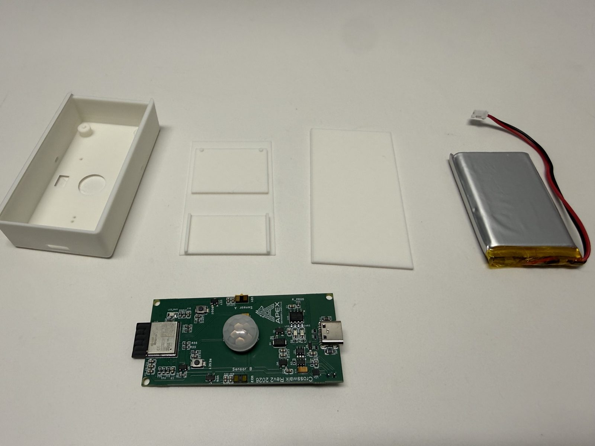
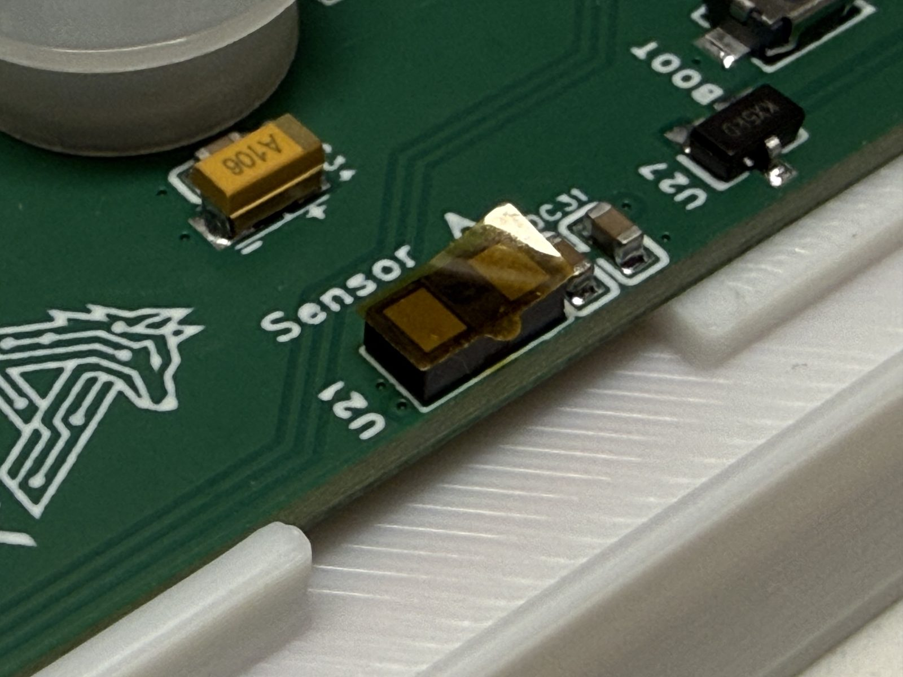
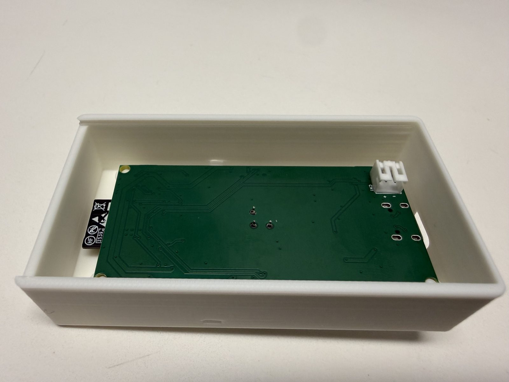
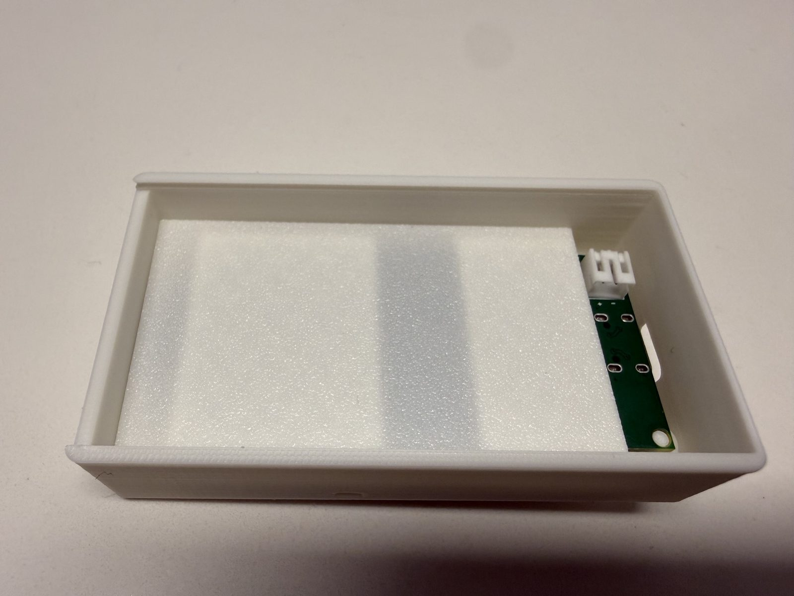
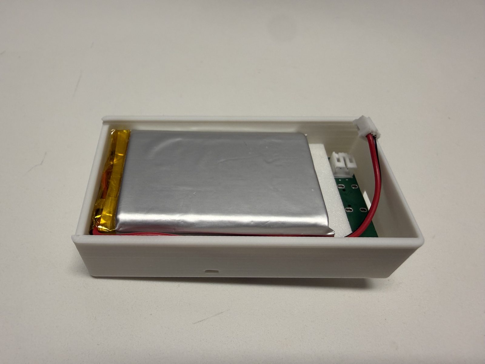
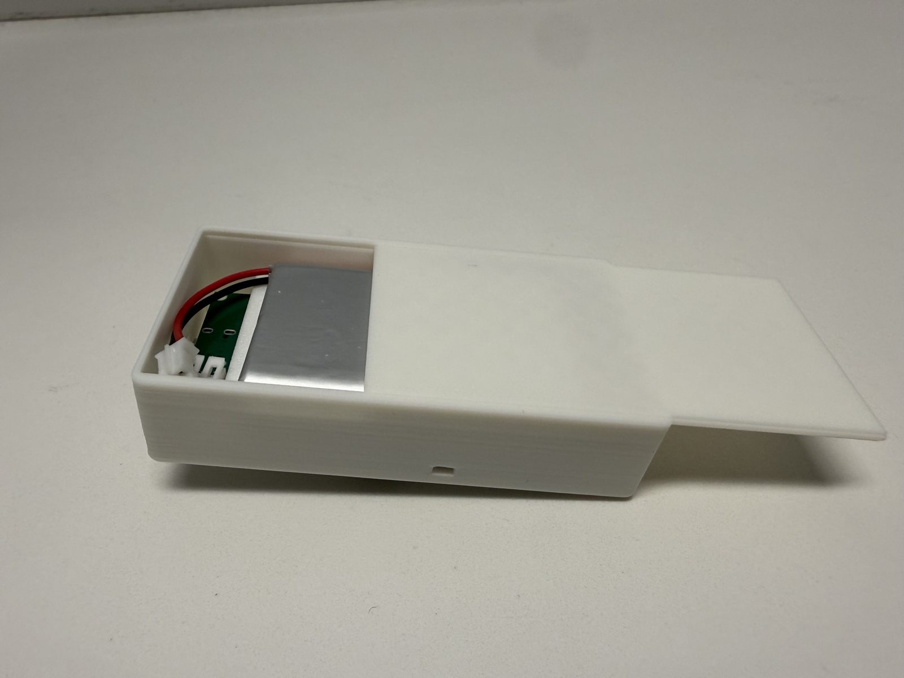
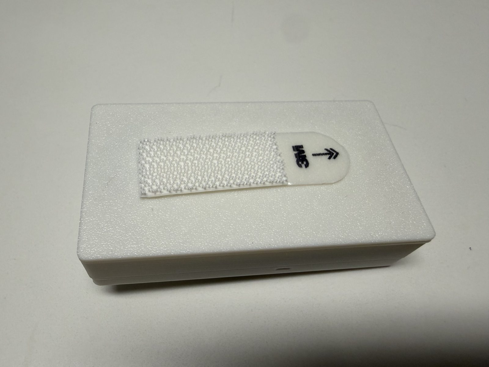

# Step 3: Assembly

Now that your sensor is paired with the Gateway, it's time to assemble the hardware and close up the case.

---

## Parts Needed
- **Flashed and paired Crosswalk Board**
- **LiPo Battery**
- **3D Printed Case & Lid**

!!! tip "Pair before you assemble"
    If you haven't paired the sensor to your Gateway yet, do that first in [Step 2](./sensor-config.md) — the battery connector is much easier to reach before the case is closed.

## Assembly Procedure

Make sure there is no film on top of either VL53L1X sensor. This comes on during shipping and will impede the sensor's ability to correctly take measurements. Remove this film very carefully, and try to not touch the sensor itself with your finger.

1.  **Board Placement:** The Crosswalk sensor is built from the "bottom" up. Place the board upside-down on the posts.

    

2. **Battery Lid:** Place the battery lid on top of the board. It should fit in the posts and align on top of the board.

    

3.  **Place Battery:** Place the battery on top of the lid and plug in the JST connector.

    

4.  **Slide on the Lid:** Slide the "top" lid in. Please note for the first time sliding in it may not slide in easily.

    

5. **Mounting Strip:** Place one of the two mounting strips on the back-side of the case. This will make it easy to remove from the doorway for charging.

    

---

-   [:octicons-arrow-right-24: **Next Step: Mounting (Step 4)**](./sensor-install.md)

