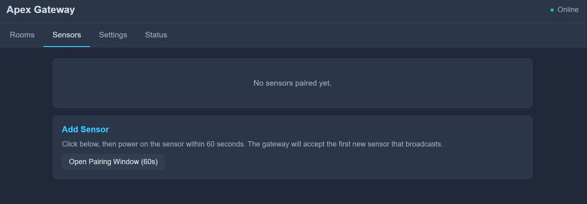
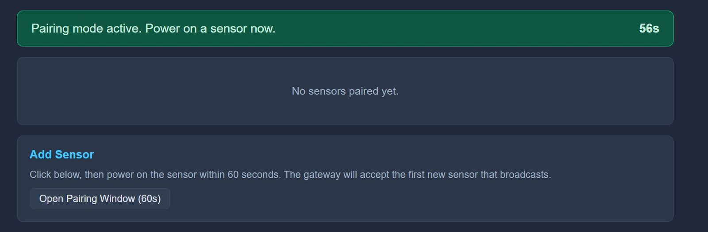
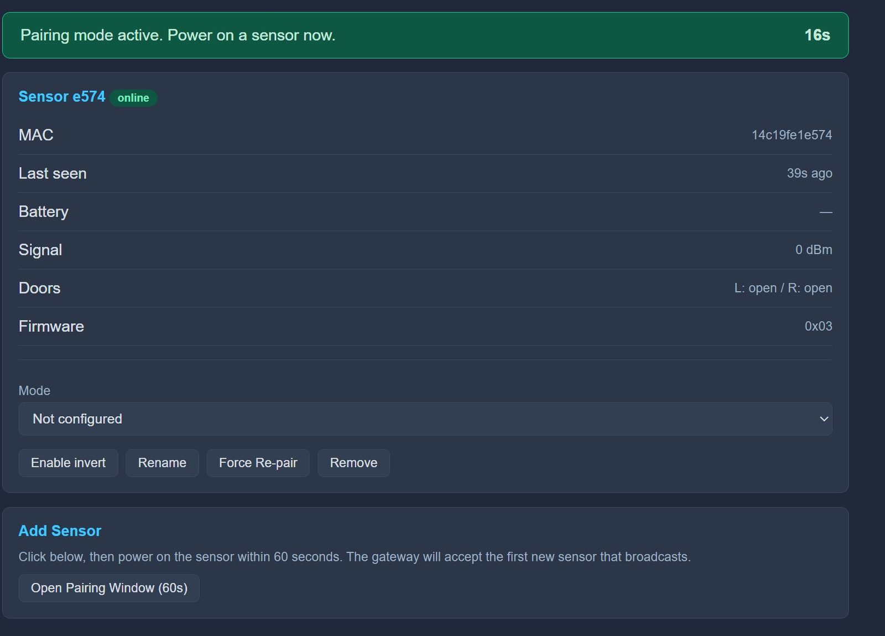

# Step 2: Pairing & Configuration

Before you assemble and mount the sensor, you need to link it to your Gateway. It's much easier to pair your Crosswalk sensor while the board is still open and you can reach the battery connector.

---

## 1. Linking to the Gateway
To add a new sensor, you must first put the Gateway into "Pairing Mode."

1.  **Open Dashboard:** Navigate to `http://apex.local` on your browser. Go to the Sensors tab.

  

2.  **Open the Pairing Window:** In the **Add Sensor** card, click **Open Pairing Window (60s)**.

  

3.  **The Countdown:** A 60-second countdown will appear on your screen that allows a Crosswalk Sensor to start pairing.

4.  **Activate the Sensor:** While the timer is counting down, plug the battery for your Crosswalk sensor into the JST connector. The sensor will automatically boot up and initiate the pairing sequence with the Crosswalk Gateway.
    - **Note:** The sensor will scan for the Gateway automatically.

    !!! info "Watch the dashboard, not the sensor"
        Once it's running on battery, the sensor keeps all of its lights off to save power — so there is no light to tell you it is awake and working. The Gateway dashboard is where you confirm pairing.

5.  **Success:** When successful, the dashboard will display "Sensor Paired Successfully" and the new device will appear in your list.

  

6. **Home Assistant:** Check out your new sensor in Home Assistant!

  

  The Apex Crosswalk Gateway should now show a connected sensor as well.

  

  Check out a Room.

  

  Now go look at the sensor.

  

---

## 2. Device Settings
Now you can customize how this sensor behaves in your home. Go back to the Apex Gateway web page.

1.  **Identify & Name:** Click on the new sensor in the list. Give it a clear name like "Office Door" or "Office - Bathroom Door".

---

## 3. Counting Modes
Crosswalk sensors can operate in different modes depending on your doorway layout. You can set the mode now, but it's easiest to confirm it is correct once the sensor is mounted and you can walk through the doorway to test it.

*   **Single Room Mode:** Best for standard rooms where the sensor is only tracking people entering and leaving one space.

*   **Dual Room Mode:** Used for sensors placed between two tracked rooms (e.g., a hallway and a kitchen). It will update the count for both rooms simultaneously. If you enter the Kitchen from the Hallway, it will increment Kitchen by +1 and decrement the Hallway by -1. This is where the Apex Crosswalk Gateway aggregation comes in. The Crosswalk sensor doesn't keep track of room counts, because rooms can have multiple doorways. All the sensors know is that someone walked under it and the direction they were traveling.

---

## 4. Fine Tuning
*   **Invert Direction:** If the sensor counts "Exit" when you are "Entering," use the **Invert** toggle. You don't need to physically remount the sensor!

---

-   [:octicons-arrow-right-24: **Next Step: Assembly (Step 3)**](./sensor-assembly.md)

