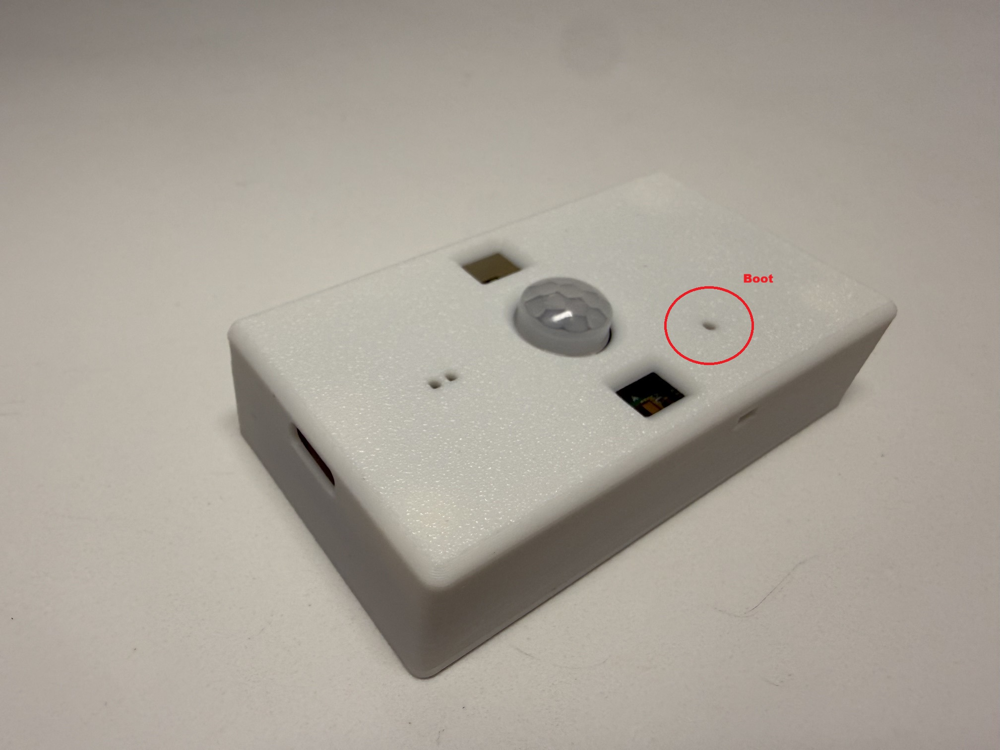

# Step 1: Flashing Your Sensor

The Crosswalk Sensor is the part that goes on your door. You need to flash it before you mount it.

!!! tip "Why we Flash First"
    To ensure you have the absolute latest features and the most secure, privacy-focused version of our local software, we start every setup by quickly updating the device's firmware. This ensures your sensor is running the most battery-efficient version of our code.

!!! info "Browser Requirement"
    You **must** use **Google Chrome** or **Microsoft Edge** on a **Windows PC or Mac** to flash your device. We do not support other browsers for flashing.

    **Reading this on your phone?** Open **docs.apexsensorlabs.com** on your computer and go to **Crosswalk Sensor → Step 1: Flashing**.

---

## Preparation
- **Crosswalk Sensor**
- **USB-C Cable**
- **Computer** with Chrome or Edge installed.
- **Paperclip** (a standard one works)

## Finding the BOOT Button

You don't need to open the case to flash the sensor. The BOOT button sits under a small slot on the top of the case, circled below. You'll press it with the end of a paperclip. This is the same on both the Battery-Powered and Hardwired versions.

## Flashing Procedure

1.  **Connect:** Push a paperclip into the BOOT slot and hold the button down. With the button held down, plug the USB-C cable into the sensor and your computer. Let go of the button once it's plugged in.

2.  **Flash:** Choose the tab that matches your sensor, then click its **Install** button.

    

    === "Battery-Powered"

        

            <esp-web-install-button manifest="../sensor-manifest.json">
                <button slot="activate" class="md-button md-button--primary">Install Crosswalk Sensor</button>
            </esp-web-install-button>
        

    === "Hardwired"

        

            <esp-web-install-button manifest="../cw-hw-manifest.json">
                <button slot="activate" class="md-button md-button--primary">Install Crosswalk Sensor (Hardwired)</button>
            </esp-web-install-button>
        

    !!! warning "Pick the Right Version"
        Both versions use the same chip, so the installer can't tell them apart. Installing the wrong one won't damage anything, but your sensor won't work correctly until you install the version that matches your hardware.

3.  **Wait:** Do not unplug the sensor until the screen says "Installation Complete". 

4.  **Ready:** Your sensor is now ready to be paired with your Gateway.

---

??? warning "Beta firmware (for testers)"
    Beta firmware lets you try new features before they're released. It's still being tested, so it may have bugs. **If you're setting up your sensor for the first time, use the regular install button above.**

    **Current beta:** lets you set the sensor's detection distance from the Gateway, for doorways taller than a standard door.

    !!! danger "Put your Gateway and all your sensors on the beta together"
        A beta sensor doesn't work with a Gateway on the regular firmware, and a regular sensor doesn't work with a beta Gateway. Install the beta on your Gateway from the [Gateway Flashing](./gateway-flashing.md) page, and on **every** sensor.

    To install it, follow the same steps above, but choose the tab that matches your sensor and click its beta button in step 2 instead:

    === "Battery-Powered"

        

            <esp-web-install-button manifest="../sensor-beta-manifest.json">
                <button slot="activate" class="md-button">Install Crosswalk Sensor (Beta)</button>
            </esp-web-install-button>
        

    === "Hardwired"

        

            <esp-web-install-button manifest="../cw-hw-beta-manifest.json">
                <button slot="activate" class="md-button">Install Crosswalk Sensor (Hardwired, Beta)</button>
            </esp-web-install-button>
        

    Just like the regular firmware, make sure you pick the version that matches your sensor.

    **Going back to the regular firmware:** Connect each sensor to your computer again and use the regular install button above. Sensors don't update on their own, so they stay on the beta until you do. Put your Gateway back on the regular firmware too (see [Gateway Flashing](./gateway-flashing.md)).

---

-   [:octicons-arrow-right-24: **Next Step: Pairing & Configuration (Step 2)**](./sensor-config.md)

