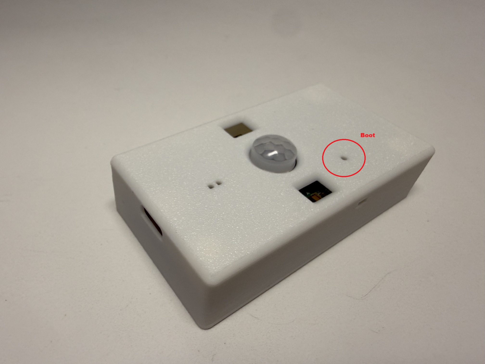

# Step 1: Flashing Your Sensor

The Crosswalk Sensor is the part that goes on your door. You need to flash it before you mount it.

!!! tip "Why we Flash First"
    To ensure you have the absolute latest features and the most secure, privacy-focused version of our local software, we start every setup by quickly updating the device's firmware. This ensures your sensor is running the most battery-efficient version of our code.

!!! info "Browser Requirement"
    You **must** use **Google Chrome** or **Microsoft Edge** on a computer to flash your device. Other browsers like Safari or Firefox do not support the connection needed.

---

## Preparation
- **Crosswalk Sensor**
- **USB-C Cable**
- **Computer** with Chrome or Edge installed.
- **Paperclip** (a standard one works)

## Finding the BOOT Button

You don't need to open the case to flash the sensor. The BOOT button sits under a small slot on the top of the case, circled below. You'll press it with the end of a paperclip. This is the same on both the Battery-Powered and Hardwired versions.

## Flashing Procedure

1.  **Connect:** Push a paperclip into the BOOT slot and hold the button down. With the button held down, plug the USB-C cable into the sensor and your computer. Let go of the button once it's plugged in.

2.  **Flash:** Choose the tab that matches your sensor, then click its **Install** button.

    

    === "Battery-Powered"

        

            <esp-web-install-button manifest="../sensor-manifest.json">
                <button slot="install" class="md-button md-button--primary">Install Crosswalk Sensor</button>
            </esp-web-install-button>
        

    === "Hardwired"

        

            <esp-web-install-button manifest="../cw-hw-manifest.json">
                <button slot="install" class="md-button md-button--primary">Install Crosswalk Sensor (Hardwired)</button>
            </esp-web-install-button>
        

    !!! warning "Pick the Right Version"
        Both versions use the same chip, so the installer can't tell them apart. Installing the wrong one won't damage anything, but your sensor won't work correctly until you install the version that matches your hardware.

3.  **Wait:** Do not unplug the sensor until the screen says "Installation Complete". 

4.  **Ready:** Your sensor is now ready to be paired with your Gateway.

---

-   [:octicons-arrow-right-24: **Next Step: Pairing & Configuration (Step 2)**](./sensor-config.md)

