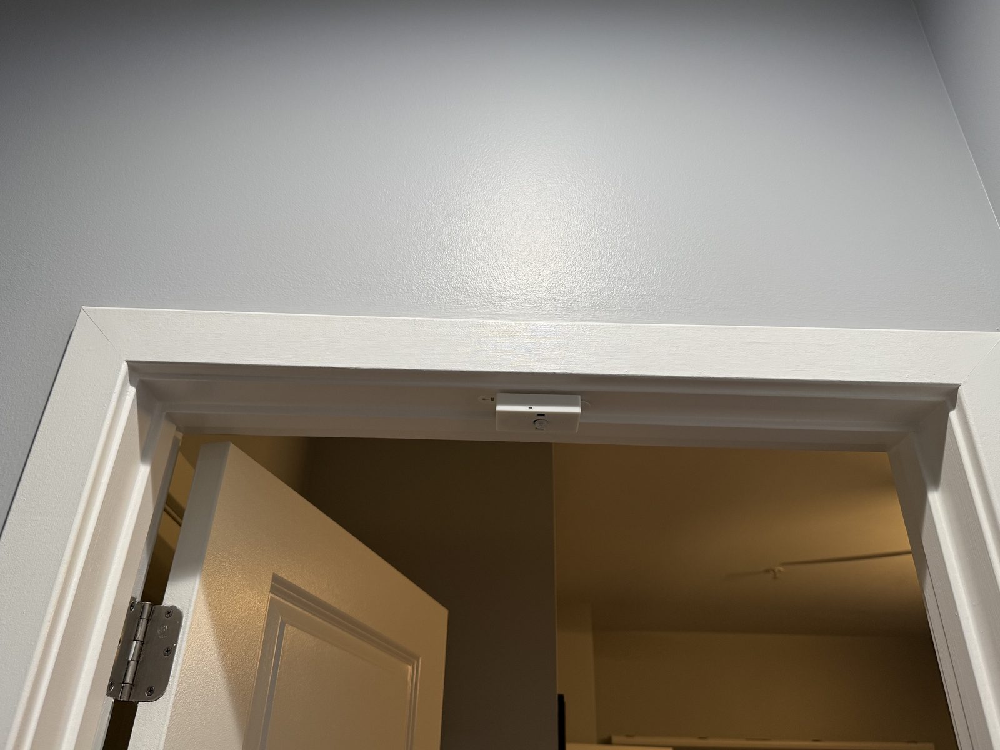
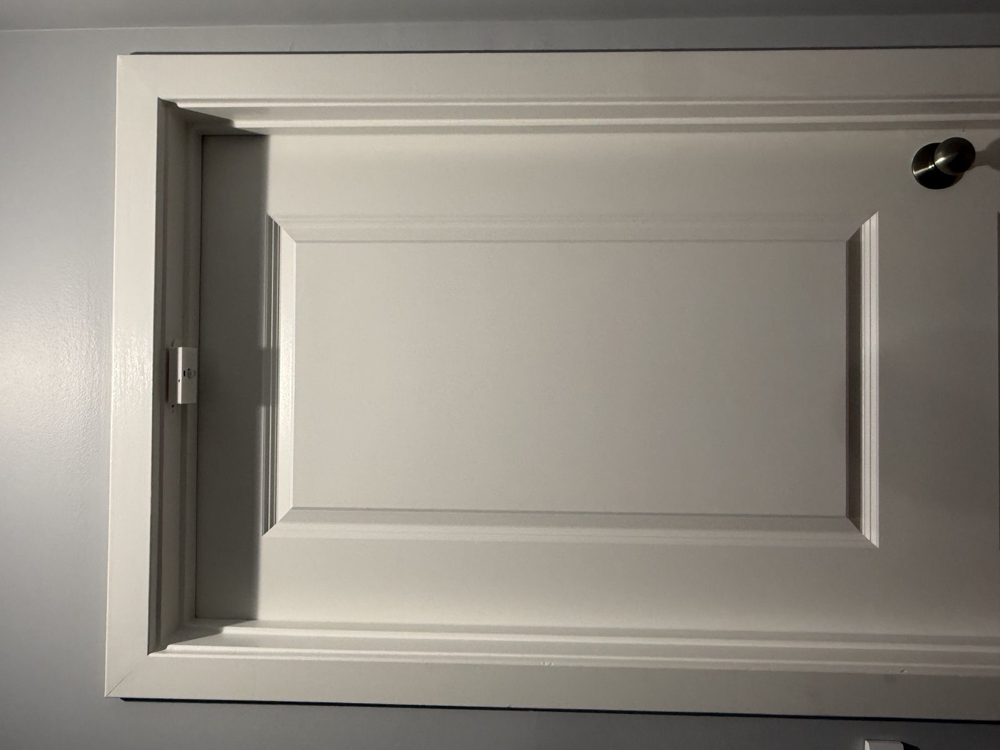

# Step 4: Mounting

Now that your sensor is configured and verified on the dashboard, it's time to put it on your door.

---

## 1. Placement

The Crosswalk sensor uses dual sensing zones to detect direction. Because you can digitally "Invert" the count in the settings, you can mount the sensor in either direction.

1.  **Mounting Height:** The Crosswalk should be placed at the **top of the doorframe**, inside the frame, pointing **down toward the floor**. Place it in the middle of the doorframe, on the inside of the door, so when the door closes it should almost rest up against the sensor.

    !!! info "Why the top of the frame"
        The sensor looks straight down through the doorway, so it sees the top of your head and shoulders as you pass underneath. Mounting it lower, or aiming it across the doorway at body height, will cause missed and miscounted passes.

  

  Far away:

  

---

## 2. Physical Installation

1.  **Clean the Surface:** Wipe the door frame with a dry cloth to ensure a good bond.
2.  **Placement:** Remove the backing from the adhesive strips and press the sensor firmly against the frame.
3.  **Power (Hardwired only):** Run a USB-C cable from the sensor to a USB power adapter in a nearby outlet. The sensor needs power at all times, so choose an outlet that isn't switched off with the lights.

    !!! info "Plan your cable route"
        Before you stick the sensor down, make sure your USB-C cable is long enough to reach the outlet. Route it so it stays clear of the door when it opens and closes.

---

## 3. Verification
1.  **Walk Through:** Pass through the doorway.
2.  **Verify:** Check your `apex.local` dashboard or your smart home app. 
3.  **Correct Direction:** If the count goes the wrong way (e.g., counts -1 when you enter), return to the [Configuration Guide](./sensor-config.md) and use the **Invert** toggle to fix it instantly.

  

  Here's the detection in Home Assistant:

  

4. Now walk back through in the opposite direction and see the count decrement.

  

---

## Setup Complete!
Your person-counting system is now live.

-   [**View Support & Help**](../support.md)
-   [**Back to Home Page**](../index.md)

