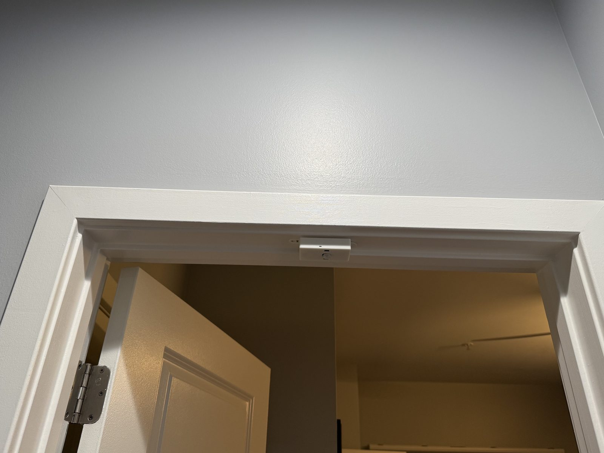
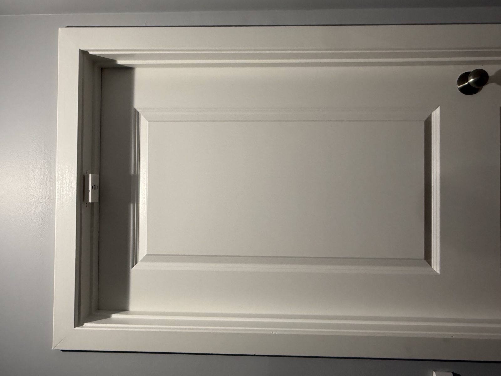
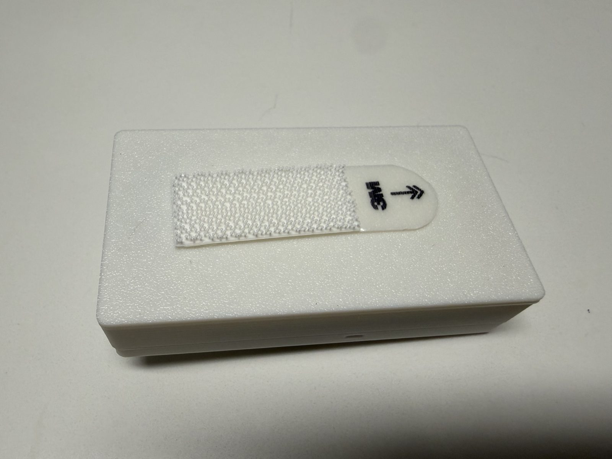

# Step 3: Mounting

Now that your sensor is paired with your Gateway, it's time to put it on your door, tell it which room or rooms to count, and test it.

---

## 1. Placement

The Crosswalk sensor uses dual sensing zones to tell which way someone is walking, so the direction you mount it matters.

1.  **Mounting Height:** The Crosswalk should be placed at the **top of the doorframe**, inside the frame, pointing **down toward the floor**. Place it in the middle of the doorframe, on the inside of the door, so when the door closes it should almost rest up against the sensor.

    !!! info "Why the top of the frame"
        The sensor looks straight down through the doorway, so it sees the top of your head and shoulders as you pass underneath. Mounting it lower, or aiming it across the doorway at body height, will cause missed and miscounted passes.

    

    Far away:

    

2.  **Direction:** Stand in the doorway, facing **into the room you want to count people entering**. Look up at where the sensor will go. The sensor's **USB-C port should be on your left**.

    ![[Placeholder: View from the doorway looking into the room, sensor on the frame above with the USB-C port on the left]]

    !!! info "Which room do I face?"
        - **Single Room:** Face the room the sensor is counting.
        - **Dual Room:** Face the room you'll set as the **Side A room** on the dashboard.

---

## 2. Physical Installation

1.  **Attach the Mounting Strip:** Take one of the adhesive mounting strips out of the sensor bag and stick it to the back of the case. Keep the second strip as a spare. The strip makes it easy to take the sensor down later for charging or servicing.

    

2.  **Clean the Surface:** Wipe the door frame with a dry cloth to ensure a good bond.
3.  **Placement:** Remove the backing from the mounting strip and press the sensor firmly against the frame.
4.  **Power (Hardwired only):** Run a USB-C cable from the sensor to a USB power adapter in a nearby outlet. The sensor needs power at all times, so choose an outlet that isn't switched off with the lights.

    !!! info "Plan your cable route"
        Before you stick the sensor down, make sure your USB-C cable is long enough to reach the outlet. Route it so it stays clear of the door when it opens and closes.

---

## 3. Set the Counting Mode

A newly paired sensor is set to **Not configured** and won't count anyone until you tell it which room or rooms it covers.

1.  **Open the Sensor:** On your `apex.local` dashboard, open the **Sensors** tab and find your sensor in the list.

2.  **Choose a Mode:** Open the **Mode** menu on the sensor's card and change it from **Not configured** to the option that fits your doorway.

    

    === "Single Room"

        Choose **Single room (one tracked)** when the sensor only needs to count people entering and leaving one room.

        Then pick that room from the **Tracked room** menu.

        

    === "Dual Room"

        Choose **Dual room (between two)** when the doorway sits between two rooms you're tracking, such as a hallway and a kitchen. Each pass updates both rooms at once: walk from the Hallway into the Kitchen and the Kitchen goes up by 1 while the Hallway goes down by 1.

        Then pick the room you faced when mounting the sensor as the **Side A room**, and the room behind you as the **Side B room**.

        

    !!! warning "Room menu not showing?"
        If the **Tracked room** menu (or the **Side A room** and **Side B room** menus) doesn't appear after you change the Mode, refresh the page in your browser. The menus will appear and your Mode choice will be kept.

!!! info "Why the Gateway keeps the count"
    The sensor itself only knows that someone walked underneath it and which way they were going. The Gateway turns that into room counts. That's why a room with several doorways can have a sensor on each one and still show one accurate total.

---

## 4. Verification
1.  **Walk Through:** Walk through the doorway into the room being counted.
2.  **Verify:** Check your `apex.local` dashboard or your smart home app. The room's count should go up by 1.

    

    Here's the detection in Home Assistant:

    

3.  **Walk Back Out:** Walk back through in the opposite direction and check the count goes back down.

    

4.  **Correct Direction:** If the count goes the wrong way (e.g., counts -1 when you enter), first check that the USB-C port is on your left when you face the room being entered. If you'd rather not remount it, open the **Sensors** tab on the dashboard, find the sensor in the list, and click its **Enable invert** button. This flips the direction instantly.

---

## Setup Complete!
Your person-counting system is now live.

-   [**View Support & Help**](../support.md)
-   [**Back to Home Page**](../index.md)

