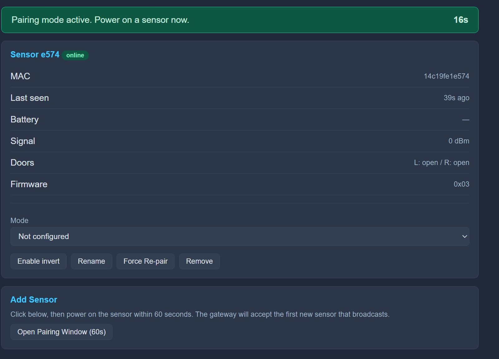

# Crosswalk Sensor Troubleshooting

Ensure your occupancy counts are accurate and your sensors are communicating reliably.

## Understanding the Sensor Lights

The Crosswalk sensor's lights are about **power**, not status. They never tell you whether the sensor is paired or counting — use your `apex.local` dashboard or your smart home app for that.

=== "Battery-Powered"

    Once it is running on battery, the sensor keeps every light off so that nothing drains the battery.

    | LED Color | When | What it Means |
    | :--- | :--- | :--- |
    | 🟡 **Yellow** | Plugged into USB | Battery is charging. |
    | 🟢 **Green** | Plugged into USB | Battery is fully charged. |
    | 🔴 **Red** | When you first plug in USB | Separate power light — the board has power. It switches off once the sensor enters deep sleep. |
    | ⚫ **No Lights** | Running on battery | Normal. All lights stay off to save battery. |

    !!! info "No lights is normal"
        On battery power there is **no light to tell you the sensor is on or working** — this is intentional, and it is how the sensor lasts months on a charge. The only place to check whether a sensor is awake, paired, and counting is your `apex.local` dashboard or your smart home app.

=== "Hardwired"

    The Hardwired sensor never sleeps, so its lights stay on whenever it has power.

    | LED Color | When | What it Means |
    | :--- | :--- | :--- |
    | 🔴 **Red** | Always, while powered | The board has power. |
    | 🟢 **Green** | Always, while powered | Normal. This is the charging light, and it shows green even though there is no battery. |
    | ⚫ **No Lights** | Any time | The sensor has no power. Check the USB-C cable and power adapter. |

---

## Installer Can't Find the Sensor
If you click **Install** and your sensor doesn't appear in the list, or the install fails right away:

1.  **Use the BOOT Button:** Unplug the sensor. Push a paperclip into the BOOT slot on top of the case and hold it down, then plug the USB-C cable back in. Let go once it's plugged in, then click **Install** again. See [Flashing](./sensor-flashing.md) for a photo of the slot.
2.  **Check the Browser:** Flashing only works in **Google Chrome** or **Microsoft Edge** on a computer.
3.  **Check the Cable:** Some USB-C cables only carry power, not data. If the sensor still doesn't appear, try a different cable.

---

## Count is Backwards or Wrong
If the room count increases when you leave and decreases when you enter:

1.  **Digital Invert:** Go to your `apex.local` dashboard, click on the sensor, and toggle the **Invert** switch. This will instantly fix the direction without you needing to move the hardware. This can be done on the Apex dashboard, or in Home Assistant via MQTT.

  

  

2.  **Clear Path:** Make sure the door doesn't block the sensor when it's open. The sensor needs a clear "line of sight" straight down through the doorway.
3.  **Mounting Position:** The sensor must sit at the **top of the doorframe pointing down at the floor**, in the middle of the opening. If it has been mounted lower down or angled across the doorway, it will miss passes. See [Mounting](./sensor-install.md) for placement.

---

## Sensor Won't Pair
1.  **Gateway Mode:** Ensure the Gateway is in **Pairing Mode** (60-second timer active) before you power the sensor on.
2.  **Power Cycle:** While the Gateway is searching, unplug the sensor's power and plug it back in — the battery's JST connector on the Battery-Powered version, or the USB-C cable on the Hardwired version. The sensor's lights don't show pairing, so watch the dashboard for confirmation instead.
3.  **Proximity:** Bring the sensor into the same room as the Gateway just for the initial pairing.

---

## Power Loss & Battery Changes
If your sensor's battery dies or you lose power to your house, don't worry!

- **No Re-Pairing Needed:** The Gateway remembers your sensors. Once you charge the sensor or the power comes back on, the sensor will automatically find the Gateway again.
- **Auto-Sync:** You do **not** need to click the "Pair" button on the dashboard again for sensors you have already set up.

---

## Battery Draining Quickly

This section applies to the Battery-Powered version only.

Charge the sensor by plugging it into USB and waiting for the light to turn from 🟡 Yellow to 🟢 Green.

If a charge isn't lasting as long as you expect:

1.  **Check the Link:** A sensor that struggles to reach the Gateway has to retry, and retries cost power. Confirm the sensor is reporting reliably on the dashboard.
2.  **Move the Gateway Closer:** If the doorway is far from the Gateway, or there are several walls between them, relocating the Gateway can make a noticeable difference.
3.  **Busy Doorways:** A very high-traffic doorway wakes the sensor more often and will shorten the interval between charges.

---

-   [:octicons-arrow-right-24: **Gateway Troubleshooting**](./gateway-troubleshooting.md)
-   [**View Support & Help**](../support.md)

